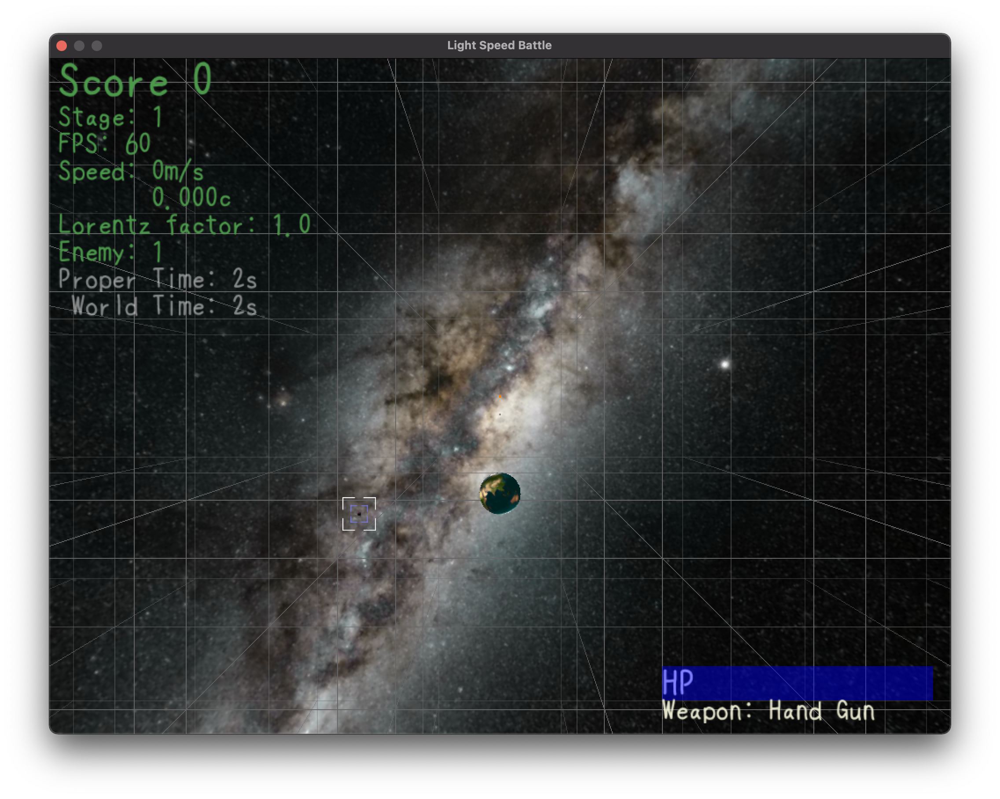
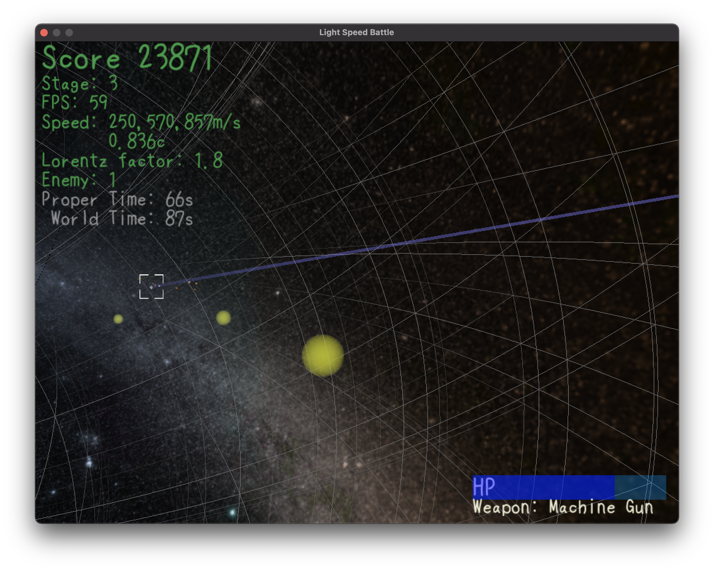

# Light Speed Battle

[日本語版 (original)](./README-ja.md)

A first-person game where you fly at a good fraction of the speed of light and see
what that does to the world: aberration, Doppler shifts, time dilation, the
cosmic microwave background coming into view, and now gravity as well.

This is a fork of [hinohi's LSBattle](https://github.com/hinohi/LSBattle), a
special-relativity FPS, by way of [sogebu's fork](https://github.com/sogebu/LSBattle).
It keeps the original game and adds general relativity: orbital flight around
real and invented bodies, Schwarzschild and Kerr black holes with lensed skies
and accretion discs, and sound and music that are Doppler and gravitationally
shifted like the light. The original's enemies, guns and score modes are still
there; most of the new work is in the Travel mode.




## What this fork adds

**Gravity and orbits.** Bodies orbit their primaries and pull on the ship. Far
from a compact body the weak field is applied in the background frame; near one
the ship follows the exact geodesic. Around a Schwarzschild hole that is the
Schwarzschild geodesic in the static or, close in, the rain frame, so the fall
goes on through the horizon. Around a spinning hole it is the Kerr geodesic in
Boyer-Lindquist coordinates, with the ship's velocity reckoned against the local
zero-angular-momentum observer, which exists all the way down to the horizon.

**Black holes.** Three of them:

| Body | What it is | Where |
|---|---|---|
| Abyss | 203,000 solar masses, GM/c³ = 1 light-second, no spin, an accretion disc from 3 to 4.5 Schwarzschild radii and six bodies on orbits from 0.15c to 0.32c | 2500 light-years from the Sun |
| Maelstrom | the same mass spinning at a/M = 0.95 (Kerr): frame dragging, a lopsided shadow, the disc down to the prograde innermost stable orbit at 1.94 M, Eddy, Beacon and Wake on prograde orbits | 3000 light-years |
| BlackHole | Gaia BH1, the nearest known stellar-mass hole, 9.6 solar masses | 1560 light-years |

The sky near a hole is drawn from a table of rays traced on the GPU each time
the ship moves: every direction is followed back to the sky, into the horizon
or into the disc, with its frequency factor. For the Kerr hole the table is the
ZAMO's and the ray tracing is the full Kerr geodesic, with exact per-pixel
tracing along the shadow's edge where the photon ring and the disc's secondary
images are finer than the table. Nearby bodies are lensed too, with their
secondary images, and the disc bends over and under the hole.

**Other systems.** Forge and Cinder, a 205,000-solar-mass star of three
Schwarzschild radii with a planet orbiting it at 0.24c; Helios, a Sun twin with
eight planets; the real solar system with Earth, the Moon, Venus, Mars, Jupiter
and Saturn on their orbits; Proxima, Sirius, Betelgeuse, Sagittarius A* and
Andromeda for interstellar trips.

**Light.** Blackbody colours with the Doppler and gravitational shifts applied
to the spectrum, auto exposure or manual, a glare pass that depends on the light
a source really sends (the Sun's surface is the reference), the cosmic
microwave background brightening into view at high speed, HDR output on Macs
with an EDR display.

**Sound.** Each body plays a theme from where it is, Doppler-shifted by its
motion and the ship's and by the gravitational shift, loud as its light would
be. The Sun plays `resources/sound/music.wav` if you put one there (we use Kevin
MacLeod's "Bathed in the Light", which is not in the repository), else a
generated loop; the other bodies play chiptune loops the game generates in
related keys. Maelstrom's is a spiral
arpeggio over a drone that wobbles with the dragged frame. See
[resources/sound/CREDITS.txt](resources/sound/CREDITS.txt).

**Flight aids.** A brake key that stops you relative to the body governing
your motion, an orbit key that puts you on the circular orbit at your radius
(the spherical orbit, off the equator of a Kerr hole, down to the photon orbit),
a booster for impulsive burns, look-at keys that point the nose at a body, at
where it will be, along your motion or along your aim, navigation markers at
bodies' retarded positions, and a HUD with speed and Lorentz factor relative to
the body you are looking at.

**Presets and the Travel-to menu.** Nine presets on the number keys set thrust,
time rate and the physics switches for a kind of flight: a 12-second Earth
orbit with an adaptive time rate, the Sun in 20 seconds, interstellar at 3 g,
each black-hole system in real time. The Travel-to menu on `p` lists the systems
and puts you in orbit there.

## Running it

Dependencies: Python 3.9 or later, PyOpenGL, Pillow, numpy, Cython to build the
`go` vector module, and SDL2. On a Mac the simplest route is the
[pysdl2-dll](https://pypi.org/project/pysdl2-dll/) wheel, which carries SDL2;
the repository's own `sdl2` binding finds it through `PYSDL2_DLL_PATH`.

```bash
python3 -m venv venv
```

```bash
venv/bin/pip install pyopengl pillow numpy cython pysdl2-dll
```

```bash
venv/bin/python cython_setup.py build_ext --inplace
```

```bash
PYSDL2_DLL_PATH=venv/lib/python3.9/site-packages/sdl2dll/dll venv/bin/python LSBattle3D.py
```

Adjust the Python version in the last path to yours. On other systems install
SDL2 from your package manager and leave `PYSDL2_DLL_PATH` unset. The game
needs OpenGL 2.1 with GLSL 1.20 and the framebuffer object and float texture
extensions, which any desktop GPU of the last fifteen years has. It is
tested on macOS with Apple silicon.

The original pipenv route (`pipenv install -d`, then `pipenv run python
LSBattle3D.py`) still works for the special-relativity game, but the gravity
and sound code needs numpy as well.

## Playing

Choose Travel from the mode menu for free flight. The keys, all rebindable in
the Key Config menu:

| Key | Action |
|---|---|
| W A S D | thrust forward, left, back, right |
| arrows | turn |
| F | booster: an impulsive burn along the nose |
| R | brake to rest relative to the governing body |
| E | brake onto the circular orbit at your radius, in the sense you are closer to |
| T, Y, U, I | look at the body under the crosshair, at where it will be, along your motion, along your aim |
| Space, V | shoot, change weapon (score modes) |
| Tab | HUD |
| 1 to 9 | presets |
| P | Travel-to menu |
| , . | thrust down, up by 1.5× |
| [ ] | time rate halved, doubled |
| ; ' | booster strength halved, doubled |
| − = | exposure down, up by half a stop |
| G J O L B N H M | toggles: grid, gravity, orbits, glare, cosmic background, markers, crosshair, sound |
| Esc | pause menu, with Settings |

Around a black hole: the shadow is black, the disc's near side is blueshifted
and bright, the far side is bent over the top. Below the innermost stable orbit
the orbit key still sets the orbit, but it is unstable and holds only while the
key is pressed. The horizon is the end: the ship is held there. Press `p` to
leave.

## Credits for this fork

The general-relativity, rendering and sound additions were written by Claude,
Anthropic's AI model (Claude Fable 5.1, working through Claude Code), with the
design, play testing and direction by [vivek](https://github.com/VH-abc). The
commits say so: each carries both names. The physics follows the standard
textbook treatments (Bardeen, Press and Teukolsky for the Kerr orbits, Carter's
constants for the geodesics, the ZAMO tetrad for the local frame), and the
harnesses that check each change against those formulas are kept outside the
repository.

Background music "Bathed in the Light" by Kevin MacLeod (incompetech.com),
licensed under Creative Commons: By Attribution 4.0. The Milky Way panorama is
ESO's, as below.

## License

### Source Code

This project is licensed under the **zlib License**, as the original.

### Assets

The assets used in this project are **licensed separately** from the source code.
Please check the individual licenses before redistribution or modification.

| Asset | Source | License |
|--------|-----------------------------------------------|-------------|
| **3D Models** | http://www.geocities.jp/oirahakobito2/sozai/sozai.html (site closed, see web archive) | **CC BY 4.0** |
| **Milky Way Image** | https://www.eso.org/public/images/eso0932a/ | **CC BY 4.0** |
| **Earth & Moon Images** | https://visibleearth.nasa.gov/ | **NASA Licensed** (Public Domain) |
| **Kiloji Font** | http://www.ez0.net/distribution/font/kiloji/ (site closed, see web archive) | **BSD 3-Clause (NewBSD License)** |
| **Einstein Image** | http://www.courseweb.uottawa.ca/Mat4183/ (site closed, see web archive) | **Public Domain** |
| **Yukkuri Marisa/Reimu** | 2ch & Niconico | **Public Domain** |
| **Bathed in the Light** | https://incompetech.com/ (Kevin MacLeod) | **CC BY 4.0** |

For assets licensed under **CC BY 4.0**, you must provide proper attribution when using them. See [Creative Commons Attribution 4.0 International](https://creativecommons.org/licenses/by/4.0/) for details.

If you have any questions regarding licensing, please check the original sources linked above or contact the respective copyright holders.
